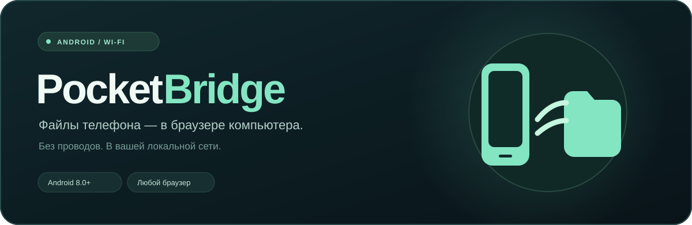

<div align="center">
  
  <br><br>
  
  
  
  
  <br><br>
  <strong>Телефон и компьютер в одной сети. Файлы — под рукой.</strong>
  <br><br>
  <a href="#quick-start">Быстрый старт</a> ·
  <a href="#features">Возможности</a> ·
  <a href="#faq">FAQ</a> ·
  <a href="#build">Сборка APK</a> ·
  <a href="#security">Безопасность</a>
</div>

<br>

**PocketBridge** — Android-приложение для работы с файлами телефона с компьютера по Wi-Fi. Запустите доступ на телефоне, откройте адрес в браузере (или подключите как сетевой диск по WebDAV) и введите код. Отдельная программа на компьютере не нужна.

> [!NOTE]
> **v3.6.1 «Обновлённый интерфейс»:** полностью переработан веб-интерфейс и экран Android-приложения (с исправлением запуска на Android 11–16 и проверкой жизненного цикла `MainActivity` на Robolectric API 26–36) — контрастные светлая и тёмная темы без мерцания, векторные SVG-иконки с цветами по типам файлов, однострочная панель инструментов на десктопе и исправленный полноширинный поиск на телефоне, галерея фото с переключением кадров (`←`/`→`) и зумом, сортировка по клику на заголовки колонок, быстрое копирование адреса WebDAV, кнопка «Поделиться» для ссылки автовхода, тёмные системные диалоги и RU/EN в самом Android-приложении, `targetSdk 36`, 184 серверных, 60 браузерных и Robolectric Android-автотесты в CI. Подробнее — в [CHANGELOG.md](CHANGELOG.md), [docs/API.md](docs/API.md) и [docs/WEBDAV.md](docs/WEBDAV.md).

> [!IMPORTANT]
> Браузер покажет предупреждение о самоподписанном сертификате — это ожидаемо. Нажмите **«Дополнительно» → «Перейти на сайт»** один раз для каждого устройства. Подробнее — в разделе [«Безопасность»](#security).

<a id="quick-start"></a>
## Быстрый старт

| 1 · Подготовьте телефон | 2 · Запустите доступ | 3 · Откройте на компьютере |
| --- | --- | --- |
| Установите APK на Android 8.0+ и разрешите доступ к файлам. | Подключите оба устройства к одной сети Wi-Fi и нажмите **«Запустить доступ»**. | Введите адрес и код в браузере, отсканируйте QR-код или откройте скопированную ссылку с кодом. |

Сервер работает в фоновом (foreground) сервисе и переживает блокировку экрана. Когда закончите, нажмите **«Остановить доступ»** в приложении или в уведомлении.

<a id="features"></a>
## Что умеет PocketBridge

| | Возможности |
| --- | --- |
| **Файловый менеджер** | Список и **плитка с миниатюрами фото/SVG**, поиск (в текущей папке или по всем вложенным, с NFC-нормализацией), создание папок, переименование и удаление, сортировка по имени/размеру/дате/типу, подсчёт размеров папок, светлая и тёмная тема, интерфейс **RU / EN**. |
| **Передача файлов** | Чанковая загрузка файлов (до 20 ГБ) и **целых папок** со структурой, перетаскивание (drag & drop), очередь с паузой, докачкой и отменой. При совпадении имён — диалог **«Перезаписать / Сохранить как / Пропустить»**. Потоковое скачивание с `Range` и скачивание файлов/папок в ZIP со структурой каталогов. |
| **Просмотр без скачивания** | Изображения (включая SVG), **HEIC и RAW** (`.heic/.heif/.dng/.cr2/.nef/.arw/.raf` — перекодирование в JPEG на сервере), PDF, текстовые и HTML-файлы, текст DOCX, потоковое воспроизведение аудио и видео с переключением треков. |
| **WebDAV и локальный доступ** | Подключение телефона как сетевого диска (`https://<IP>:<порт>/dav/`) в Проводнике Windows, macOS Finder и `rclone`. HTTPS с X.509 v3 сертификатом (RSA-2048 + SAN), QR-код и ссылка автовхода (`https://…/#k=…`), смена кода одной кнопкой, настройки порта, автостопа (15/30/60 мин или никогда) и удержания экрана. |

<details>
<summary><strong>Форматы и ограничения просмотра</strong></summary>
<br>

- **Изображения:** JPEG, PNG, GIF, WebP, BMP, AVIF, SVG (SVG до 5 МБ, открывается с изолирующим `Content-Security-Policy: sandbox`).
- **HEIC и RAW:** `.heic`, `.heif`, `.dng`, `.cr2`, `.nef`, `.arw`, `.raf` (до 50 МБ) — перекодируются на сервере в JPEG для просмотра; при скачивании отдаётся исходный файл.
- **Аудио и видео:** MP3, M4A, WAV, OGG, OPUS, FLAC, MP4, M4V, WebM, OGV, MOV — потоково с поддержкой `Range`, при поддержке кодека браузером.
- **Документы и текст:** PDF, DOCX, TXT, MD, CSV, LOG, JSON, XML, CSS, JS, HTML/HTM. Текстовые файлы для просмотра ограничены 5 МБ.
- **DOCX:** извлекается текст без оформления и изображений (XML до 8 МБ, DTD запрещён).
- **HTML:** открывается в `<iframe sandbox>` с запретом скриптов и внешних ресурсов.
- **ZIP:** до 500 выбранных объектов и до 5 000 вложенных файлов за один запрос; поддерживаются отдельные файлы, группы файлов и целые папки с сохранением структуры.
- **WebDAV:** `https://<IP-телефона>:8765/dav/` (логин любой, пароль — код доступа с экрана телефона).

</details>

<a id="faq"></a>
## Часто задаваемые вопросы (FAQ)

### Почему браузер ругается на сертификат?
Приложение генерирует на телефоне собственный сертификат X.509 v3 (RSA-2048, SAN для локальных IP и `localhost`). Он шифрует трафик по HTTPS, но не подписан публичным центром сертификации — для локального устройства без доменного имени это стандартно. Нажмите **«Дополнительно» → «Перейти на сайт»** один раз.

### Почему не видны файлы в хранилище?
На Android 11+ приложению требуется разрешение «Доступ ко всем файлам» (`MANAGE_EXTERNAL_STORAGE`). Нажмите **«Разрешить доступ к файлам»** на главном экране или включите его в `Настройки → Приложения → PocketBridge → Разрешения`.

### Работает ли подключение через интернет или CGNAT?
PocketBridge принимает подключения только из локальных сетей (RFC 1918, loopback, CGNAT `100.64.0.0/10`, IPv6 ULA и link-local). Телефон и компьютер должны быть в одной Wi-Fi сети (или подключены к точке доступа телефона). Доступ из интернета заблокирован намеренно.

### Можно ли подключить телефон как сетевой диск в Windows или macOS?
Да — через встроенный WebDAV (`https://<IP-телефона>:8765/dav/`). Логин — любой (например, `pb`), пароль — код доступа с экрана телефона. Подробная инструкция — в [docs/WEBDAV.md](docs/WEBDAV.md).

### Сколько работает сервер после блокировки экрана?
Сервер работает в foreground-сервисе с активным `WifiLock` и не прерывает передачу при выключенном экране. Автостоп срабатывает через 15, 30 или 60 минут без подключений (либо отключён — настраивается на главном экране).

<a id="build"></a>
## Сборка APK и тесты

**Понадобятся:** JDK 17 и Android SDK (`platforms;android-36`, `build-tools;36.0.0`).

```bash
# Сборка отладочного APK (Linux / macOS)
./gradlew assembleDebug
# -> app/build/outputs/apk/debug/app-debug.apk

# Автономные тесты сервера, TLS и WebDAV (JDK 17, без Android SDK)
./server-tests/run.sh
```

```bat
:: Windows
gradlew.bat assembleDebug
```

**Подписанный release (APK + AAB для Google Play):**

```bash
export PB_KEYSTORE=/path/to/pocketbridge.jks
export PB_KEYSTORE_PASSWORD=...
# опционально, если отличаются от значений по умолчанию:
export PB_KEY_ALIAS=pocketbridge
export PB_KEY_PASSWORD=...

./gradlew assembleRelease bundleRelease
# -> app/build/outputs/apk/release/app-release.apk
# -> app/build/outputs/bundle/release/app-release.aab
```

Ключ подписи не хранится в репозитории и передаётся только через переменные окружения (или GitHub Actions Secrets: `PB_KEYSTORE_BASE64`, `PB_KEYSTORE_PASSWORD`, опционально `PB_KEY_ALIAS`, `PB_KEY_PASSWORD`).

<details>
<summary><strong>Сборка через GitHub Actions</strong></summary>
<br>

1. Откройте вкладку **Actions** в репозитории.
2. Выберите workflow **Build & Test** и нажмите **Run workflow**.
3. После прохождения серверных и браузерных тестов скачайте артефакт **PocketBridge-debug-apk** (или **PocketBridge-release**, если настроены секреты подписи).
4. При отправке тега `v*` автоматически создаётся GitHub Release с файлами сборки и `SHA256SUMS.txt`.

</details>

<a id="security"></a>
## Безопасность и доступ к файлам

- **HTTPS и X.509 v3:** ключ RSA-2048 и самоподписанный сертификат X.509 v3 (`BasicConstraints: CA=false`, `KeyUsage`, `ExtendedKeyUsage: serverAuth`, `SubjectAlternativeName`) создаются на устройстве, хранятся в приватном каталоге и автоматически перевыпускаются при истечении 2-летнего срока.
- **Ограничение самоподписанного сертификата:** защищает от пассивного перехвата трафика, но при первом подключении сверяйте адрес на экране телефона и пользуйтесь доверенной сетью.
- **Изоляция контента (CSP):** главная страница защищена `Content-Security-Policy`; HTML-превью открывается в `<iframe sandbox>`, а SVG и HTML в `/preview`, `/thumb` и `/dav` отдаются с `Content-Security-Policy: default-src 'none'; sandbox`, исключая выполнение встроенных скриптов.
- **Защита кода доступа:** сравнение ключа выполняется за константное время (`MessageDigest.isEqual`); в уведомлении на заблокированном экране код скрыт (`VISIBILITY_PRIVATE` + публичная версия без кода); в URL-ссылке `#k=…` код передаётся во фрагменте и сразу удаляется из адресной строки.
- **Удержание Wi-Fi и очистка кеша:** на время работы сервера удерживается `WifiLock` (`WAKE_LOCK`), временные `.part`-файлы удаляются при отмене/остановке, кеш миниатюр ограничен 200 МБ.
- **Временные ссылки:** тикеты `/preview` и `/dl` разделены по типу, действуют 10 минут и не содержат кода доступа; сессия миниатюр `/thumb` действует 2 часа.

<br>
<div align="center">
  
  <br><sub>Сделано, чтобы файлы были ближе.</sub>
</div>
