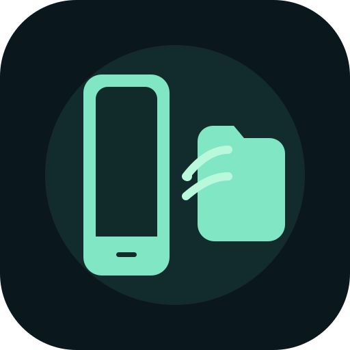

<div align="center">
  
  <br><br>
  
  
  
  
  <br><br>
  <strong>Телефон и компьютер в одной сети. Файлы — под рукой.</strong>
  <br><br>
  <a href="#quick-start">Быстрый старт</a> ·
  <a href="#features">Возможности</a> ·
  <a href="#faq">FAQ</a> ·
  <a href="#build">Сборка APK</a> ·
  <a href="#security">Безопасность</a>
</div>

<br>

**PocketBridge** — Android-приложение для работы с файлами телефона с компьютера по Wi-Fi. Запустите доступ на телефоне, откройте адрес в браузере (или подключите как сетевой диск по WebDAV) и введите код. Отдельная программа на компьютере не нужна.

> [!NOTE]
> **4.9.0 RC2 (кандидат после ревью):** докачка загрузок из браузера, общая корзина, страницы больших папок, пакетное переименование, сохраняемые фильтры, SHA‑256-проверка папок, дубликаты и профили доступа. [Руководство и ограничения](docs/SELECTED-4X.md). Это не опубликованный стабильный релиз.

> [!NOTE]
> **v4.0.1 «Обновление без переустановки»:** стабильные APK подписываются постоянным ключом владельца. APK с тем же сертификатом можно обновить поверх, сохранив настройки. Для перехода с несовместимых debug-сборок v3.9/v4.0 потребуется одна чистая установка. [Инструкция перехода](docs/RELEASE.md#migrate).

> [!NOTE]
> **v4.0 «Доступ под контролем»:** плитка PocketBridge в быстрых настройках, приём файлов и текста через Android «Поделиться», подключение через точку доступа и Bonjour/mDNS, выбор общей папки и серверный режим «Только чтение» для браузера и WebDAV. Подробнее — в [CHANGELOG.md](CHANGELOG.md).

> [!IMPORTANT]
> Браузер покажет предупреждение о самоподписанном сертификате — это ожидаемо. Нажмите **«Дополнительно» → «Перейти на сайт»** один раз для каждого устройства. Подробнее — в разделе [«Безопасность»](#security).

<a id="quick-start"></a>
## Быстрый старт

| 1 · Подготовьте телефон | 2 · Запустите доступ | 3 · Откройте на компьютере |
| --- | --- | --- |
| Установите APK на Android 8.0+ и разрешите доступ к файлам. | Подключите оба устройства к одной сети Wi-Fi или к точке доступа телефона. Нажмите **«Запустить доступ»**. | Введите адрес и код в браузере, отсканируйте QR-код или откройте скопированную ссылку с кодом. |

Сервер работает в фоновом (foreground) сервисе и переживает блокировку экрана. Когда закончите, нажмите **«Остановить доступ»** в приложении, на плитке или в уведомлении.

### Быстрые настройки и «Поделиться»

- **Плитка:** на Android 13+ откройте **PocketBridge → Настройки → Плитка PocketBridge**. На любой поддерживаемой версии можно добавить её вручную через **Быстрые настройки → Изменить**. Если не дан доступ к файлам или прошивка блокирует фоновый запуск, плитка откроет приложение.
- **Файлы:** в Галерее или файловом менеджере нажмите **«Поделиться» → PocketBridge → «Сохранить»**. Файлы (до 32, суммарно до 2 ГиБ) импортируются в `PocketBridge Inbox` внутри общей папки. Существующие имена не перезаписываются. В браузере нажмите «Обновить», затем откройте **«Входящие»**.
- **Текст/ссылки:** выберите PocketBridge в меню «Поделиться». При активном сервере подтверждённый текст заменяет общий буфер; при остановленном текст сохраняется в `Shared text.txt` во «Входящих». Импорт сам по себе не запускает сервер.

### Точка доступа и mDNS

Включите **Точку доступа** в системных настройках телефона, подключите компьютер к этой сети и откройте адрес или QR из PocketBridge. Используйте адрес точки доступа (показанный в приложении; также его можно узнать как шлюз Wi-Fi на компьютере). Интернет для обмена не нужен.

**Настройки → Обнаружение mDNS** включает объявление `PocketBridge` типа `_https._tcp`. Клиент Bonjour/DNS-SD, например `dns-sd -B _https._tcp local.` на macOS, найдёт сервис и его порт. Переключатель не регистрирует фиксированный адрес `pocketbridge.local`. Если сеть не пропускает multicast, подключайтесь по адресу или QR. Код доступа не публикуется через mDNS.

### Что доступно клиентам

- **Настройки → Общая папка** ограничивает браузер и WebDAV выбранной папкой в основном общем хранилище. Она отображается как `/`. Если папка пропала, выберите другую: PocketBridge не откроет всё хранилище вместо неё.
- **Настройки → Режим доступа → Только чтение** оставляет просмотр, скачивание и SHA-256, но запрещает загрузку, редактирование, распаковку, удаление и отправку в буфер из браузера. Вы по-прежнему можете импортировать файлы и делиться текстом прямо с телефона.
- Смена папки или режима завершает активную сессию, поэтому после неё понадобится новый код.

<a id="features"></a>
## Что умеет PocketBridge

| | Возможности |
| --- | --- |
| **Файловый менеджер** | Список и **плитка с миниатюрами фото, видео и SVG** (с учётом EXIF-ориентации), **быстрые и закреплённые папки**, поиск (в текущей папке или по всем вложенным, с NFC-нормализацией), создание папок и **текстовых файлов**, **копирование, перемещение (включая drag & drop в папки)**, переименование и удаление, **просмотр и распаковка `.zip` на месте**, карточка **«Свойства» и проверка `SHA-256`** (`Alt+Enter`), выделение диапазона `Shift+клик` и горячие клавиши (`Ctrl+A/C/X/V/S`, `R`, `F2`, `Delete`, `/`, `Alt+↑`), сортировка и фильтры по типам, светлая и тёмная тема, интерфейс **RU / EN**. |
| **Передача и буфер обмена** | Чанковая загрузка файлов (до 20 ГБ) и **целых папок** со структурой (кнопкой или перетаскиванием), вставка скриншотов и файлов по **`Ctrl+V`**, очередь с паузой, докачкой, скоростью и ETA, **общий текстовый буфер ПК ↔ телефон** (до 64 КБ, только в памяти сессии). При совпадении имён — диалог **«Перезаписать / Сохранить как / Пропустить»**. Потоковое скачивание с `Range` и скачивание файлов/папок в ZIP со структурой каталогов. |
| **Просмотр и правка на месте** | Изображения (с EXIF-ориентацией, поворотом `R`/`Shift+R` и сохранением поворота JPEG/PNG/WebP, включая SVG), **HEIC и RAW** (`.heic/.heif/.dng/.cr2/.nef/.arw/.raf` — перекодирование в JPEG на сервере), **встроенный редактор текста и конфигов** (`.txt`, `.md`, `.json`, `.ini`, `.cfg`, `.yml`, `.xml`, `.csv`, код — `Ctrl+S` с защитой от конфликтов `mtime`), **инспектор и распаковщик `.zip`**, PDF, HTML, текст DOCX, потоковое воспроизведение аудио и видео с переключением треков. |
| **WebDAV и локальный доступ** | Подключение телефона как сетевого диска (`https://<IP>:<порт>/dav/`) в Проводнике Windows, macOS Finder и `rclone`. HTTPS с X.509 v3 сертификатом (RSA-2048 + SAN), QR-код и ссылка автовхода (`https://…/#k=…`), смена кода одной кнопкой, настройки порта, автостопа (15/30/60 мин или никогда) и удержания экрана. |

<details>
<summary><strong>Форматы и ограничения просмотра</strong></summary>
<br>

- **Изображения:** JPEG, PNG, GIF, WebP, BMP, AVIF, SVG (автоматическая EXIF-ориентация; сохранение поворота на 90/180/270° для JPEG/PNG/WebP до 40 МБ и 36 МП; SVG до 5 МБ открывается с изолирующим `Content-Security-Policy: sandbox`).
- **HEIC и RAW:** `.heic`, `.heif`, `.dng`, `.cr2`, `.nef`, `.arw`, `.raf` (до 50 МБ) — перекодируются на сервере в JPEG для просмотра с учётом EXIF; при скачивании отдаётся исходный файл.
- **Аудио и видео:** MP3, M4A, WAV, OGG, OPUS, FLAC, MP4, M4V, WebM, OGV, MOV, MKV, 3GP — потоково с поддержкой `Range`, миниатюры кадров видео в режиме плитки (`MediaMetadataRetriever` + дисковый кеш).
- **Документы, текст и редактор:** PDF, DOCX, TXT, MD, CSV, TSV, LOG, JSON, XML, YAML, TOML, INI, CFG, CONF, PROPERTIES, CSS, JS, TS, PY, JAVA, KT, SH, SQL, HTML/HTM и др. — просмотр до 5 МБ, встроенное создание и редактирование в UTF-8 до 2 МБ с проверкой `mtime`.
- **DOCX:** извлекается текст без оформления и изображений (XML до 8 МБ, DTD запрещён).
- **HTML:** открывается в `<iframe sandbox>` с запретом скриптов и внешних ресурсов; исходный код можно редактировать в режиме правки.
- **ZIP (скачивание и распаковка):** сборка ZIP до 500 выбранных объектов и до 5 000 вложенных файлов; просмотр `.zip` до 2 000 отображаемых записей (UTF-8 и `CP866`) и распаковка на телефоне до 10 000 объектов / 2 ГБ с защитой от Zip Slip, симлинков и Zip Bomb.
- **Свойства и `SHA-256`:** метаданные файлов и папок, EXIF-размеры изображений и потоковый расчёт `SHA-256` (для файлов до 4 ГБ) со сверкой хеша.
- **WebDAV:** `https://<IP-телефона>:8765/dav/` (логин любой, пароль — код доступа с экрана телефона).

</details>

<a id="faq"></a>
## Часто задаваемые вопросы (FAQ)

### Почему браузер ругается на сертификат?
Приложение генерирует на телефоне собственный сертификат X.509 v3 (RSA-2048, SAN для локальных IP и `localhost`). Он шифрует трафик по HTTPS, но не подписан публичным центром сертификации — для локального устройства без доменного имени это стандартно. Нажмите **«Дополнительно» → «Перейти на сайт»** один раз.

### Почему не видны файлы в хранилище?
На Android 11+ приложению требуется разрешение «Доступ ко всем файлам» (`MANAGE_EXTERNAL_STORAGE`). Нажмите **«Разрешить доступ к файлам»** на главном экране или включите его в `Настройки → Приложения → PocketBridge → Разрешения`.

### Работает ли подключение через интернет или CGNAT?
PocketBridge принимает подключения только из локальных сетей (RFC 1918, loopback, CGNAT `100.64.0.0/10`, IPv6 ULA и link-local). Телефон и компьютер должны быть в одной Wi-Fi сети (или подключены к точке доступа телефона). Доступ из интернета заблокирован намеренно.

### Можно ли подключить телефон как сетевой диск в Windows или macOS?
Да — через встроенный WebDAV (`https://<IP-телефона>:8765/dav/`). Логин — любой (например, `pb`), пароль — код доступа с экрана телефона. Подробная инструкция — в [docs/WEBDAV.md](docs/WEBDAV.md).

### Сколько работает сервер после блокировки экрана?
Сервер работает в foreground-сервисе с активным `WifiLock` и не прерывает передачу при выключенном экране. Автостоп срабатывает через 15, 30 или 60 минут без подключений (либо отключён — настраивается на главном экране).

<a id="build"></a>
## Сборка APK и тесты

**Понадобятся:** JDK 17 и Android SDK (`platforms;android-36`, `build-tools;36.0.0`).

```bash
# Сборка отладочного APK (Linux / macOS)
./gradlew assembleDebug
# -> app/build/outputs/apk/debug/app-debug.apk

# Автономные тесты сервера, TLS и WebDAV (JDK 17, без Android SDK)
./server-tests/run.sh
```

```bat
:: Windows
gradlew.bat assembleDebug
```

**Подписанный release (APK + AAB):** настройте постоянный ключ и отпечаток сертификата по [инструкции выпуска](docs/RELEASE.md). Для QA без ключа владельца есть отдельная [проверка обновления и чек-лист телефонов](docs/DEVICE-CHECKS.md).

<details>
<summary><strong>Сборка через GitHub Actions</strong></summary>
<br>

- На ветке или по **Actions → Build & Test → Run workflow** доступен артефакт **PocketBridge-debug-apk** для тестов, не для стабильного обновления.
- Стабильный APK публикуется только по тегу `v<версия>` с коммита `main` после тестов, проверки обновления на Android и проверки подписи в окружении `release`. Если ключ или отпечаток не настроен, GitHub Release **не создаётся**: debug-сборка не подставляется.

</details>

<a id="security"></a>
## Безопасность и доступ к файлам

- **HTTPS и X.509 v3:** ключ RSA-2048 и самоподписанный сертификат X.509 v3 (`BasicConstraints: CA=false`, `KeyUsage`, `ExtendedKeyUsage: serverAuth`, `SubjectAlternativeName`) создаются на устройстве, хранятся в приватном каталоге и автоматически перевыпускаются при истечении 2-летнего срока.
- **Ограничение самоподписанного сертификата:** защищает от пассивного перехвата трафика, но при первом подключении сверяйте адрес на экране телефона и пользуйтесь доверенной сетью.
- **Изоляция контента (CSP):** главная страница защищена `Content-Security-Policy`; HTML-превью открывается в `<iframe sandbox>`, а SVG и HTML в `/preview`, `/thumb` и `/dav` отдаются с `Content-Security-Policy: default-src 'none'; sandbox`, исключая выполнение встроенных скриптов.
- **Защита кода доступа:** сравнение ключа выполняется за константное время (`MessageDigest.isEqual`); в уведомлении на заблокированном экране код скрыт (`VISIBILITY_PRIVATE` + публичная версия без кода); в URL-ссылке `#k=…` код передаётся во фрагменте и сразу удаляется из адресной строки.
- **Удержание Wi-Fi и очистка кеша:** на время работы сервера удерживается `WifiLock` (`WAKE_LOCK`), временные `.part`-файлы удаляются при отмене/остановке, кеш миниатюр ограничен 200 МБ.
- **Временные ссылки:** тикеты `/preview` и `/dl` разделены по типу, действуют 10 минут и не содержат кода доступа; сессия миниатюр `/thumb` действует 2 часа.

<br>
<div align="center">
  
  <br><sub>Сделано, чтобы файлы были ближе.</sub>
</div>
